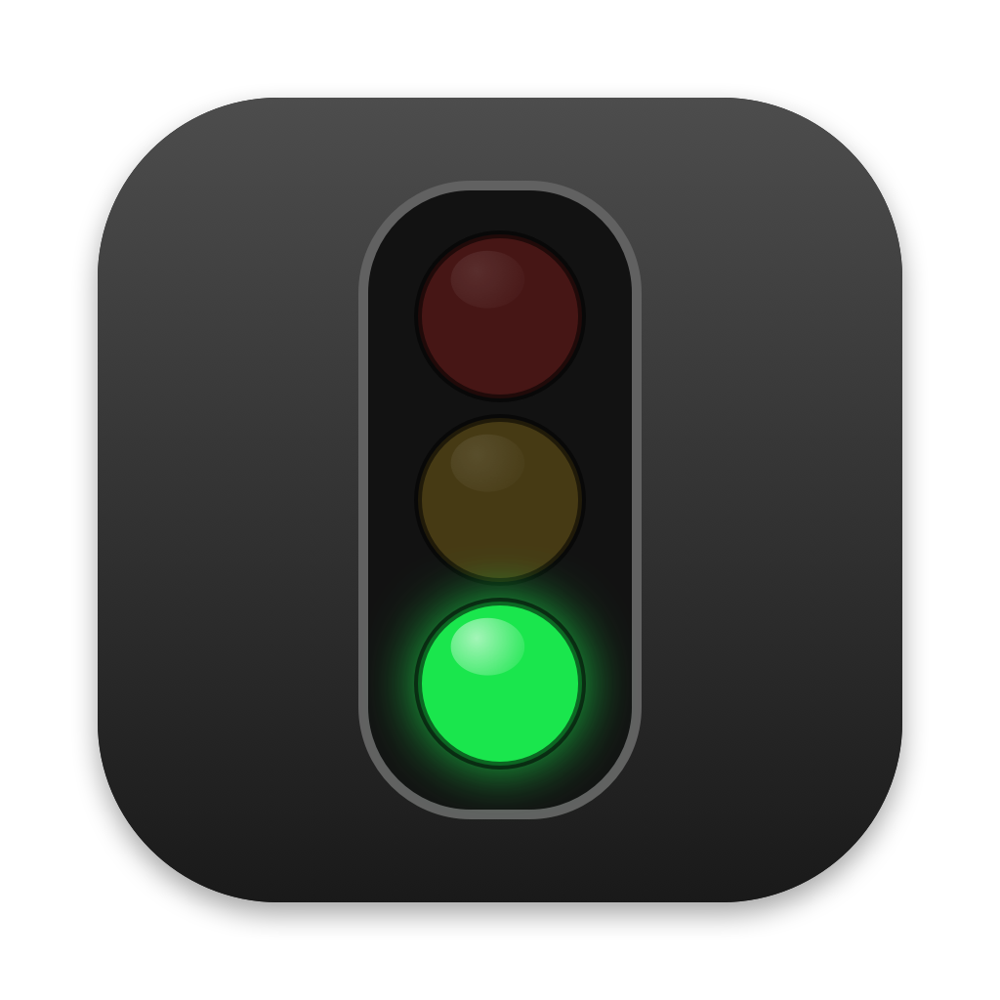
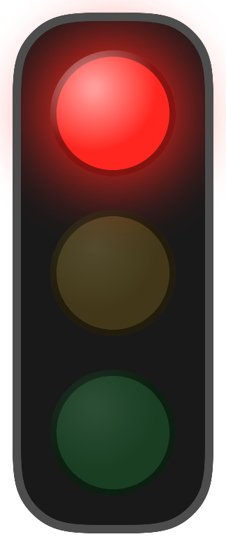
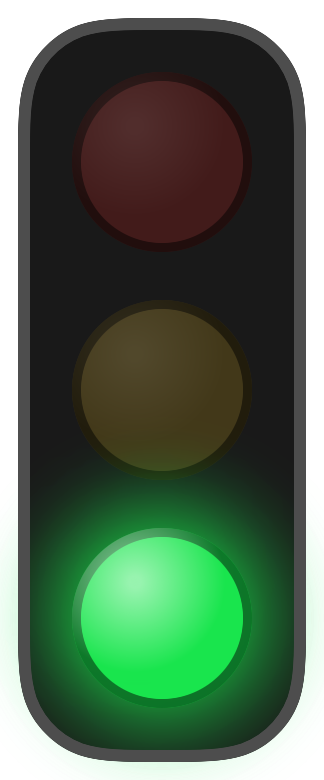

# Claude Light



A tiny floating traffic light for macOS that shows what [Claude Code](https://claude.com/claude-code) is doing:

- 🔴 **Red**: Claude is working.
- 🟢 **Green**: Claude has finished (or is waiting for you).

The widget is small, stays on top of other windows, never steals focus, and can be dragged anywhere. It remembers where you put it.

<p align="center">
  
  &nbsp;&nbsp;&nbsp;&nbsp;
  
  <br>
  <sub>Red: Claude is working &nbsp;·&nbsp; Green: Claude has finished</sub>
</p>

## How it works

Claude Code [hooks](https://docs.claude.com/en/docs/claude-code/hooks) call a small helper (`claude-light-hook`) on each event. The helper writes one state file per session to `~/.claude-light/sessions/`. The app polls that folder four times a second and lights the lamp.

| Hook event | Light |
|---|---|
| `UserPromptSubmit`, `PreToolUse`, `PostToolUse` | Red |
| `Stop`, `Notification` | Green |
| `SessionEnd` | Session removed |

With several Claude Code sessions open, the light is red if **any** session is working. A session that has been "working" for over 10 minutes with no events is treated as stale and no longer holds the light red, so a crashed session can't leave it stuck.

The hook is fast (about 16 ms median), always exits 0 and prints nothing, so it can't slow down or break Claude Code.

## Requirements

- macOS 13 or later
- Swift 6 toolchain (Xcode or the Command Line Tools). There is no Xcode project, only Swift Package Manager.
- Claude Code

## Download

Grab `ClaudeLight-<version>-macos.zip` from the [latest release](https://github.com/raza-kontakt/claude-status/releases/latest). It runs on Apple Silicon and Intel Macs (macOS 13+).

1. Unzip it and drag **ClaudeLight.app** into `/Applications`.
2. The app is ad-hoc signed, not notarized, so macOS blocks it on first launch. Clear the download flag once, then open it:

   ```bash
   xattr -dr com.apple.quarantine /Applications/ClaudeLight.app
   open /Applications/ClaudeLight.app
   ```

   (Or right-click the app, choose *Open*, then confirm.)
3. Connect Claude Code, then restart any running Claude Code sessions:

   ```bash
   /Applications/ClaudeLight.app/Contents/MacOS/claude-light-install install
   ```

4. Optional: right-click the widget and tick *Start at Login*.

To remove it, run the same installer with `uninstall`, then delete the app.

## Build from source

```bash
git clone https://github.com/raza-kontakt/claude-status.git
cd claude-status
scripts/setup.sh
```

`setup.sh` builds the app, installs the hooks and opens the widget. Restart any running Claude Code sessions so they pick up the hooks.

To keep it in Applications:

```bash
cp -R build/ClaudeLight.app /Applications/
/Applications/ClaudeLight.app/Contents/MacOS/claude-light-install uninstall
/Applications/ClaudeLight.app/Contents/MacOS/claude-light-install install --hook /Applications/ClaudeLight.app/Contents/MacOS/claude-light-hook
```

(Uninstall first: `install` leaves entries that already exist untouched, so it won't change their path.)

The app is ad-hoc signed, not notarized. It runs fine when built locally.

## Usage

- **Move**: drag the widget anywhere.
- **Quit**: right-click, then *Quit Claude Light*.
- **Start at login**: right-click, then tick *Start at Login*. It uses the system's login items, so you can also manage it in System Settings > General > Login Items. Run the app from `/Applications` first, because macOS ties the login item to the app's location.
- It has no Dock icon.

## Hooks and your settings

The installer edits `~/.claude/settings.json` carefully:

- It adds its hooks without touching your other settings or hooks.
- It is idempotent, so running it twice doesn't duplicate entries.
- It refuses to edit a file that isn't valid JSON.
- `uninstall` removes only its own entries (matched by `claude-light-hook`).

The hooks use the absolute path of the app they were installed from. If you move or delete the app, run `uninstall` and `install` again.

## Development

```bash
swift build                      # debug build
swift test                       # unit tests (state machine, parsing, installer, position)
scripts/build-app.sh             # build/ClaudeLight.app
scripts/verify-render.sh         # render the widget red/green offscreen and check the pixels
scripts/make-icns.sh             # regenerate Resources/AppIcon.icns
```

Handy flags and variables:

| | |
|---|---|
| `ClaudeLight --snapshot out.png red\|green` | Render the widget to a PNG |
| `--selftest-quit`, `--selftest-drag`, `--selftest-login` | Check the right-click menu, dragging and the Start at Login toggle (`--selftest-login` flips the setting) |
| `CLAUDE_LIGHT_SNAPSHOT_SCALE=6`, `CLAUDE_LIGHT_SNAPSHOT_TRANSPARENT=1` | Hi-res, transparent snapshots (how `docs/*.png` were made) |
| `CLAUDE_LIGHT_DEBUG=1` | Log light changes to stderr |
| `CLAUDE_LIGHT_DIR=/path` | Use a different state folder (default `~/.claude-light`) |
| `claude-light-install --settings PATH` | Install into a different settings file (for testing) |

### Layout

```
Sources/
  ClaudeLightCore/        state machine, signal parsing, state store, settings installer, position store
  claude-light-app/       floating SwiftUI/AppKit widget
  claude-light-hook/      the hook helper Claude Code calls
  claude-light-install/   install / uninstall CLI
Tests/ClaudeLightCoreTests/
scripts/                  build, setup, verification, icon generation
specs/001-claude-traffic-light/   Spec Kit spec, plan, tasks, contracts
```

This project was built with [GitHub Spec Kit](https://github.com/github/spec-kit). The spec, plan and task list are in `specs/001-claude-traffic-light/`.

## Uninstall

```bash
build/ClaudeLight.app/Contents/MacOS/claude-light-install uninstall
rm -rf /Applications/ClaudeLight.app ~/.claude-light
```

Then right-click the widget and choose *Quit Claude Light*.

## License

[MIT](LICENSE). Claude Light is an independent project and is not affiliated with or endorsed by Anthropic.
